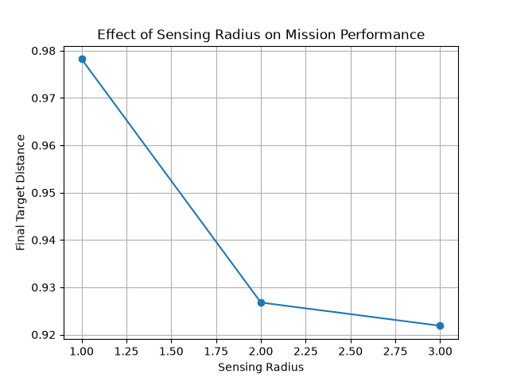
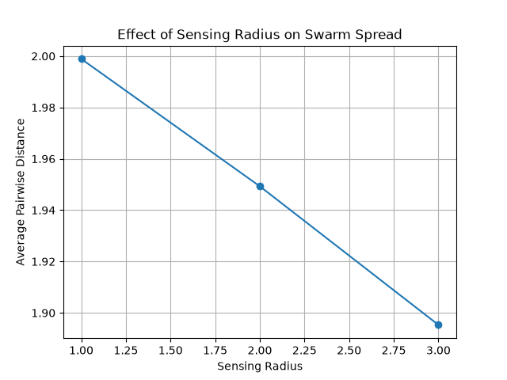
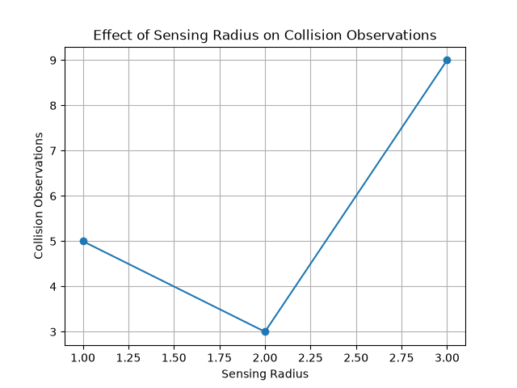

# SwarmSense — Sensing Radius Experiment

## 1. Objective

The objective of this experiment was to investigate how the sensing radius of autonomous robots affects decentralized swarm coordination and situational awareness.

We tested whether increasing the distance at which robots can detect their neighbours changes:

- How close the swarm gets to a target.
- How compactly the robots organize themselves.
- How frequently robots experience collisions.

## 2. Experimental Setup

We tested three sensing-radius values:

- 1.0
- 2.0
- 3.0

For each sensing radius, we performed 10 independent simulation runs.

Each simulation used:

- 20 autonomous robots.
- 100 simulation steps.
- The same initial-condition seed set across sensing-radius conditions.
- Identical simulation parameters apart from sensing radius.

Using the same set of random seeds helps make the comparison between sensing radii fairer.

## 3. Performance Metrics

We evaluated three metrics.

### Final Distance to Target

The average distance of the swarm's robots from the target at the end of the simulation.

Lower values indicate that the swarm finished closer to the target.

### Average Swarm Spread

The average pairwise distance between robots, averaged over all simulation steps.

Lower values indicate a more compact swarm.

### Collision Observations

The total number of collision observations recorded across all simulation steps.

This metric counts robot overlaps at each time step. The same pair of robots can therefore contribute multiple observations.

## 4. Results

Results are reported as mean ± standard deviation across 10 runs.

| Sensing Radius | Final Target Distance | Average Swarm Spread | Collision Observations |
| -------------- | --------------------: | -------------------: | ---------------------: |
| 1.0            |         0.950 ± 0.017 |        1.955 ± 0.053 |            7.60 ± 3.34 |
| 2.0            |         0.919 ± 0.014 |        1.907 ± 0.052 |           11.50 ± 4.38 |
| 3.0            |         0.902 ± 0.011 |        1.867 ± 0.051 |           10.40 ± 2.07 |

## 5. Visual Results

The following figures illustrate how sensing radius affects swarm performance across the 10 simulation runs. Error bars represent one standard deviation.

5.1 Final Distance to Target

5.2 Average Swarm Spread

5.3 Collision Observations

## 6. Interpretation

### Target Approach

Increasing the sensing radius was associated with a reduction in final distance to the target.

The mean decreased from 0.950 at a sensing radius of 1.0 to 0.902 at a sensing radius of 3.0.

This suggests that access to information about more distant neighbours may help the swarm coordinate its movement towards the target.

### Swarm Compactness

Average swarm spread decreased as sensing radius increased.

The mean decreased from 1.955 to 1.867.

This suggests that a larger sensing radius may help robots maintain a more compact formation.

### Collision Observations

Collision observations did not decrease consistently as sensing radius increased.

The highest mean was recorded at a sensing radius of 2.0, while the lowest was recorded at 1.0.

This suggests that improved coordination and swarm compactness do not necessarily lead to fewer collision observations.

## 7. Limitations

This experiment has several limitations:

- Only three sensing-radius values were tested.
- Each condition used 10 simulation runs.
- Collision observations count overlaps across time steps rather than unique collision events.
- The results describe this particular simulation configuration and should not automatically be generalized to all robot swarms.
- The experiment does not establish statistical significance or prove causation.

## 8. Conclusion

Within the tested simulation conditions, increasing sensing radius was associated with slightly better target approach and a more compact swarm.

However, collision observations did not show a consistent decrease.

These findings suggest that sensing radius can influence decentralized swarm coordination, but improvements in coordination do not necessarily improve every performance metric.

Further experiments could investigate additional sensing radii, more simulation runs, and alternative collision-avoidance strategies.
